<div align="center">

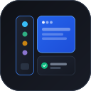

# TabbedClient

**Modern, zero-telemetriás, multi-account webes munkaállomás teljes munkamenet-izolációval és vertikális fülekkel.**  
*Nyílt forráskódú, biztonságos és erőforrás-takarékos alternatíva a Rambox, Franz és Ferdi alkalmazások helyett.*

[](#telepítés-és-futtatás)
[-success.svg)](#-zero-telemetria-és-adatvédelem)
[](#-5-professzionális-téma)
[](LICENSE)

<br>

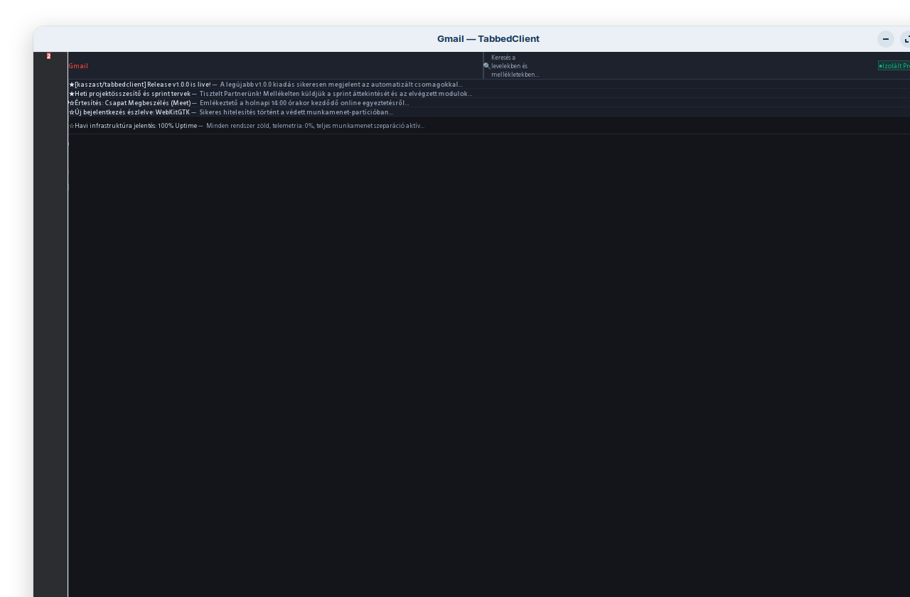

</div>

---

## 🌟 Kiemelt Tulajdonságok

- 🛡️ **Teljes Munkamenet-Izoláció (Multi-Account Partitions):** Minden fül külön, elszeparált adatkörnyezetet (Cookie Jar, Cache, IndexedDB, LocalStorage) kap. Egymás mellett futtatható több privát és céges fiók (pl. több Gmail vagy WhatsApp) kijelentkezés és profilváltás nélkül.
- 🔒 **Zero-Telemetria & 100% Adatvédelem:** Nincs beépített analitika, nincs harmadik féltől származó mérőkód, nincs hirdetéskövetés és nincs külső szerverfüggőség.
- 🎨 **5 Professzionális Téma:** Letisztult sötét és világos felületek (Slate Studio, Nordic Crisp, JetBrains Obsidian, Solarized Paper, Enterprise Cobalt).
- 📐 **Kompakt és Kiterjeszthető Vertikális Fülsáv:** 2x-es méretű, jól látható vektoros és favicon ikonok, olvasatlan üzenet badge-ek és egykattintásos összecsukás (48px széles ikon-mód).
- 🚀 **9 Beépített Szolgáltatás-Sablon:** Egykattintásos hozzáadás WhatsApp Web, Slack, Telegram, Gmail, Discord, Trello, Google Calendar, Notion és ProtonMail szolgáltatásokhoz.
- 🔔 **Rendszertálca & Háttérműködés:** Rendszertálca (AyatanaAppIndicator3) integráció, minimalizálás bezáráskor, jobb-klikkes gyorsmenü.
- 🔗 **Intelligens Külső Linkkezelés:** Az e-mailekből, chatekből megnyitott hivatkozások (pl. Gmail *"View in browser"*, hírlevelek) automatikusan a rendszer alapértelmezett böngészőjében (Firefox, Chrome stb.) nyílnak meg.
- 🔍 **Oldal-Nagyítás (Zoom Engine):** Teljes oldalas arányos zoom `Ctrl + egérgörgővel`, valamint `Ctrl + +`, `Ctrl + -` és `Ctrl + 0` gyorsbillentyűkkel.

---

## 📸 Képernyőképek és Felület

### 1. Központi Irányítópult (Dashboard)
A kezdőlapon áttekinthetők az aktív fülek, a munkamenet-profilok, az értesítési számlálók és a legnépszerűbb szolgáltatások egykattintásos gyorsgombjai:

<p align="center">
  
</p>

---

### 2. Témarendszer (5 Jóváhagyott Stílus)

A TabbedClient öt gondosan megtervezett színvilágot kínál, amelyek a munkaállomás típusához igazíthatók:

| 01. Slate Studio (Mélyszürke sötét) | 02. Nordic Crisp (Tiszta skandináv világos) |
| :---: | :---: |
| 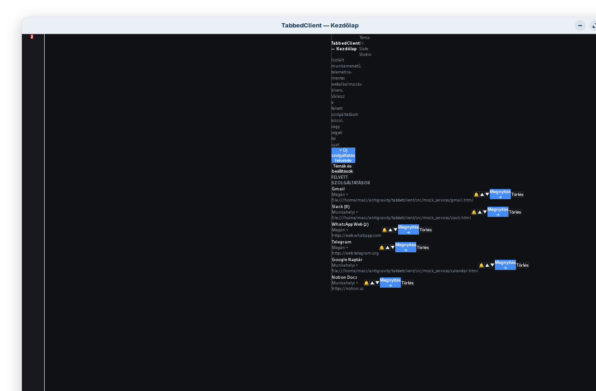 | 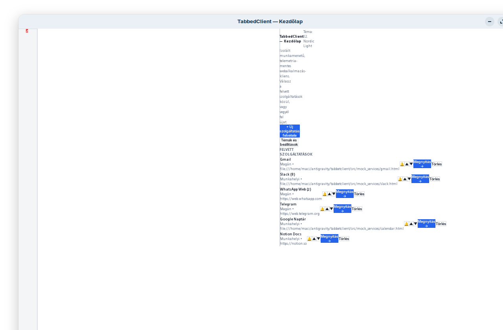 |
| **03. JetBrains Obsidian (Mérnöki sötét IDE)** | **08. Solarized Paper (Akadémiai szépia / Kékfény-mentes)** |
| 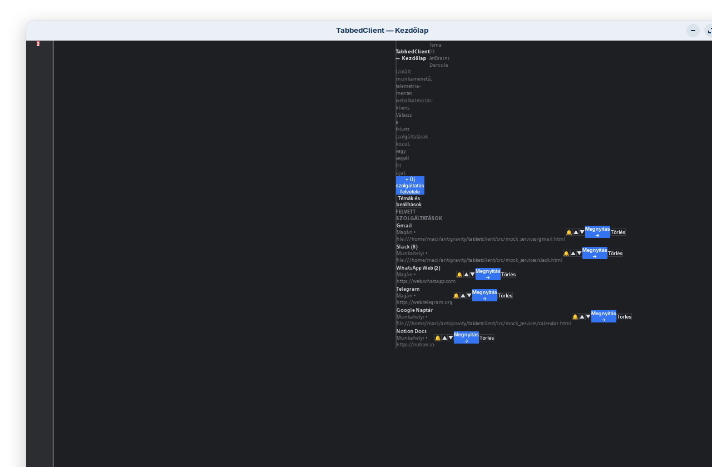 | 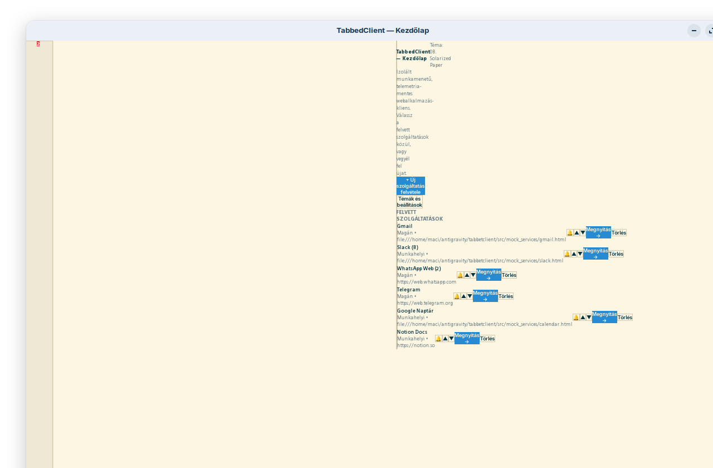 |

<p align="center">
  <b>10. Enterprise Cobalt (Vállalati tiszta fehér & kobaltkék)</b><br>
  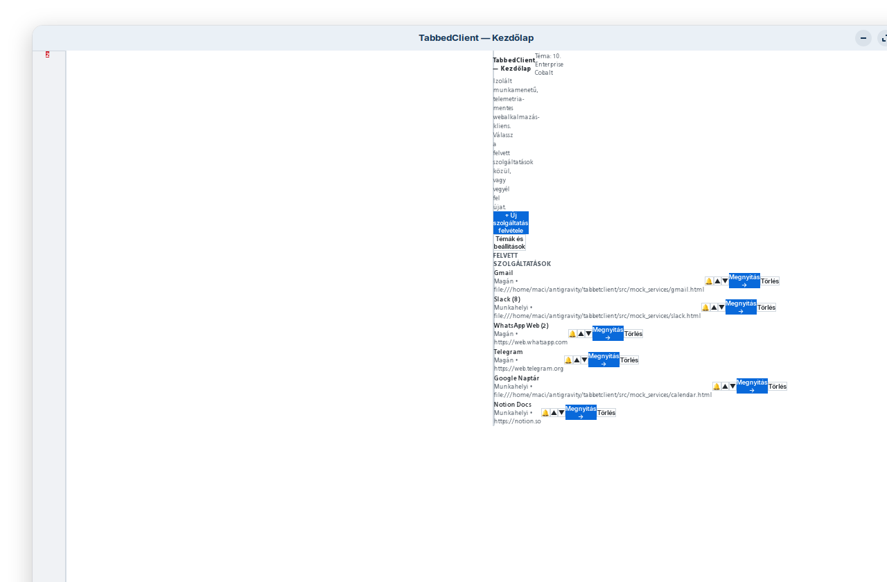
</p>

---

### 3. Fülkezelés és Beállítások Modálok

| Új Fül Hozzáadása & 9 Sablon | Rendszerbeállítások & Témaválasztó |
| :---: | :---: |
| 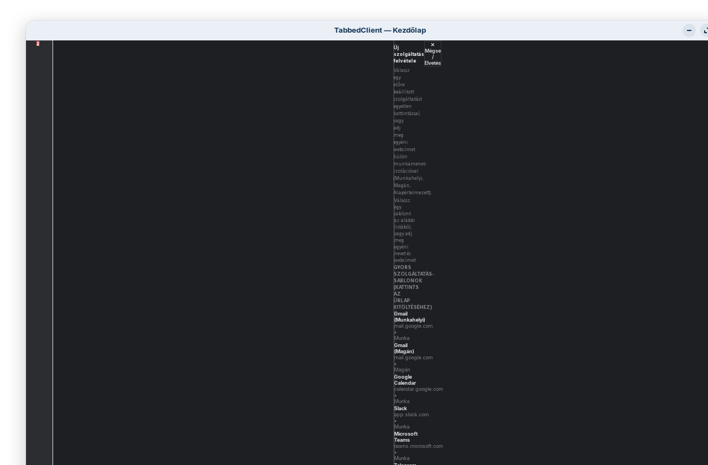 | 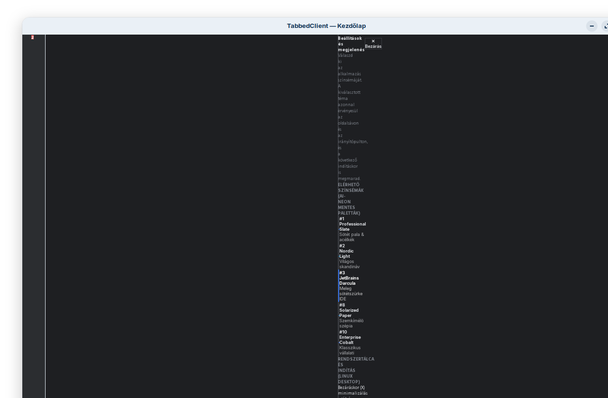 |

---

### 4. Kompakt Fülsáv & Munkamenet-Izoláció

| Kompakt Icon-Only Mód (48px) | Partíciók és Profiljelzők |
| :---: | :---: |
| 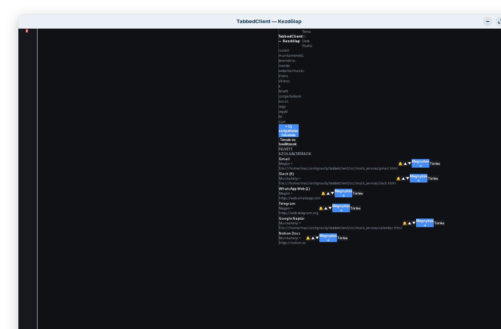 | 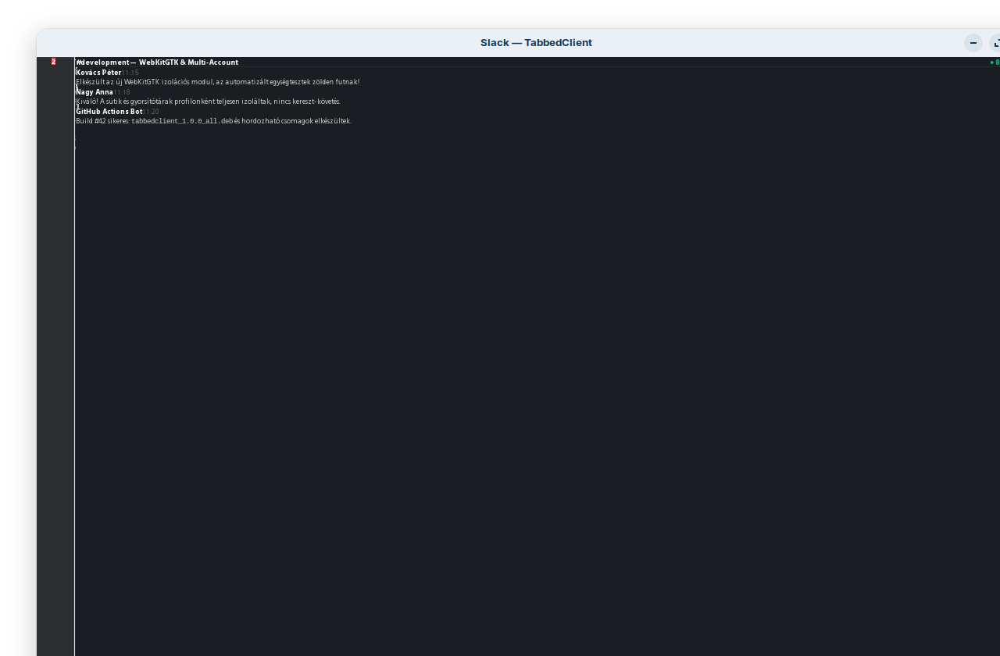 |

---

## 💻 Rendszerkövetelmények

- **Linux:** Zorin OS, Ubuntu 22.04 / 24.04, Debian 11 / 12, Linux Mint vagy egyéb GTK3 alapú disztribúció.
- **Windows:** Windows 10 / 11 (64-bit).

---

## 🚀 Telepítés és Futtatás

### Linux környezet (Debian / Ubuntu / Zorin OS)

#### 1. Telepítés `.deb` csomagból (Ajánlott)
A hivatalos Debian csomag automatikusan integrálja az alkalmazást az asztali menübe és a tálcára a Bento ikonnal:

```bash
sudo dpkg -i dist/tabbedclient_1.0.0_all.deb
```

Ha hiányoznának rendszerfüggőségek:
```bash
sudo apt install -f
```

*Szükséges csomagok:*
```bash
sudo apt install python3-gi gir1.2-gtk-3.0 gir1.2-webkit2-4.1 gir1.2-ayatanaappindicator3-0.1
```

#### 2. Hordozható (Portable) Linux futtatás
Telepítés nélkül, közvetlenül a forrásból vagy a `.tar.gz` archívumból:

```bash
# Csomagold ki vagy lépj a mappába:
./tabbedclient

# Tálcára kitűzés és asztali parancsikon aktiválása hordozható módban:
./install_desktop_entry.sh
```

---

### Windows környezet (Windows 10 / 11)

A letölthető `dist/tabbedclient-1.0.0-windows.zip` teljes mértékben hordozható, nem igényel rendszergazdai jogot:

1. Csomagold ki a `.zip` archívumot egy tetszőleges mappába.
2. Kattints duplán a **`TabbedClient.vbs`** fájlra (csendes indítás fekete parancssor nélkül).
   *(Alternatívaként a `TabbedClient.bat` is használható.)*

*Működés Windows alatt:*
- Ha Python 3.9+ telepítve van, a natív Python vezérlő indul el.
- Ha nincs Python a gépen, automatikusan a Windows beépített **Microsoft Edge App Mode** motorját indítja el elszeparált adatprofilokkal.

---

## ⌨️ Gyorsbillentyűk

| Billentyűkombináció | Művelet |
| :--- | :--- |
| `Ctrl` + `Egérgörgő FEL` | Oldal nagyítása (Zoom In) |
| `Ctrl` + `Egérgörgő LE` | Oldal kicsinyítése (Zoom Out) |
| `Ctrl` + `+` / `Ctrl` + `=` | Oldal nagyítása billentyűzetről |
| `Ctrl` + `-` | Oldal kicsinyítése billentyűzetről |
| `Ctrl` + `0` | Nagyítás visszaállítása alapértelmezettre (100%) |
| `Ctrl` + `Bal Klikk` / `Középső Egérgomb` | Link azonnali megnyitása külső alapértelmezett böngészőben |

---

## 📂 Konfiguráció és Adatbiztonság

Az alkalmazás az **XDG Base Directory** szabványt követi:
- **Konfiguráció:** `~/.config/tabbedclient/config.json`
- **Adatprofilok, Sütik és Gyorsítótár:** `~/.local/share/tabbedclient/profiles/<profil_id>/`
- **Hordozható mód:** Amennyiben a program melletti `./data` mappa írható, a program oda ment (USB meghajtón hordozható konfiguráció).

---

## 🛠️ Fejlesztés és Tesztelés

```bash
# Automatikus egységtesztek futtatása:
npm test

# Alkalmazás indítása tesztüzemmódban:
npm start

# Telepítő- és archívumcsomagok újraépítése (.deb, .tar.gz, .zip):
npm run build:packages

# Képernyőképek automatikus újragenerálása:
python3 scripts/generate_screenshots.py
```

---

## 📄 Licenc

Ez a projekt az **ISC Licenc** feltételei szerint szabadon használható és terjeszthető.
